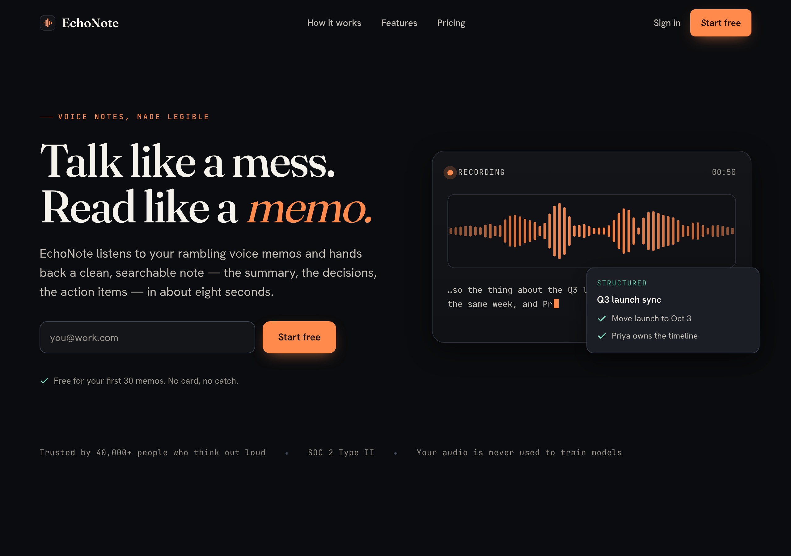
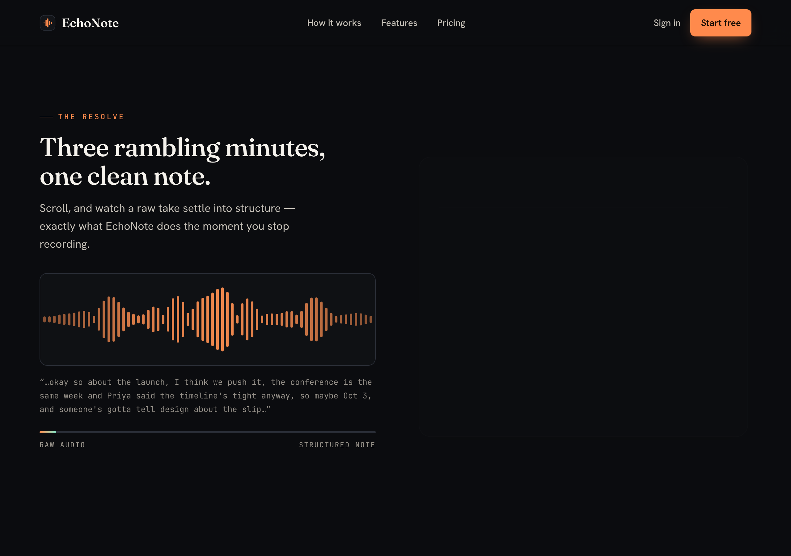

# EchoNote — UI Craft showcase build

**Live page: https://howard-jek.github.io/ui-craft-showcase/**

One landing page, built end-to-end by Claude Opus 4.8 running the
[ui-craft skill](https://github.com/Howard-Jek/ui-craft) with its full motion/effects toolkit
unlocked (GSAP + ScrollTrigger + SplitText, Lenis smooth scroll, hand-drawn Canvas 2D
waveform). Single self-contained `index.html`, no build step — libraries load from CDN.

The signature move: **"The Resolve"** — a live waveform in the hero that, as you scroll,
collapses a raw rambling transcript into a clean structured note, scrubbed frame-for-frame by
your scroll position. The page performs the product instead of describing it.

| | |
|---|---|
| Desktop hero |  |
| The Resolve mid-scroll |  |

## The experiment

Same brief, same model (Opus 4.8), three configurations. Toolkit = the skill's
`motion-and-effects.md` reference (loaded only when the signature move is motion/scroll/3D).

| Configuration | Tokens¹ | Judge score | Independent audit² |
|---|---|---|---|
| Opus baseline (no skill) | 80,917 | — (no judge) | **4 contrast errors**, 0 focus styles, Inter body face |
| Opus + skill (plain HTML/CSS) | 294,664³ | PASS 8.3 | 0 errors |
| **Opus + skill + toolkit (this page)** | **182,688** | **PASS 8.7** | **0 errors** — 375/768/1280, normal + reduced-motion, console clean |

¹ Orchestrating-agent tokens; the LLM-judge subagent each with-skill run spawns is billed
separately (roughly 100–120k more). Single runs — directional, not statistical.
² Grader re-ran the skill's `ui_audit.js` independently rather than trusting self-reports.
³ Inflated: that run was interrupted by a session limit and resumed, replaying its transcript.
The uninterrupted toolkit run is the fairer picture of steady-state cost: **~2.3× baseline
tokens for a page that ships zero defects instead of four, plus a judge-verified 8.7.**

## What the toolkit bought over the plain with-skill run

- A scroll-choreographed signature moment (GSAP ScrollTrigger scrub + Lenis sync) that plain
  CSS could not express — this is the +0.4 judge delta and the memorability
- SplitText headline reveal, with the reduced-motion path rendering final text immediately
- Restraint held: three libraries total, one orchestrated moment, Canvas 2D chosen over
  three.js/OGL because the waveform didn't need GPU weight (the skill's decision framework
  working as intended)

## Honesty section

- **Known edge case** (found in independent verification): an extreme in-place viewport resize
  (1280 → 375 without reload) leaves ScrollTrigger/canvas geometry stale and overflows until
  reload. Fresh loads at any width are clean; phone rotation ranges are unaffected in testing.
- Accessibility floors verified: `prefers-reduced-motion` gives a fully static page with all
  content immediate; both canvases have static fallbacks and pause offscreen; page works with
  JS entirely absent (progressive enhancement); real `
`-free mobile menu with ARIA;
  visible focus everywhere; muted text is a solid ~6.7:1 token.
- The judge (fresh-context adversarial subagent) found one real High bug (orphaned mobile CTA)
  plus 3 Mediums and 2 nits — all fixed and re-audited before this was published.

## Process evidence

[`docs/BRIEF.md`](docs/BRIEF.md) · [`docs/GATES.md`](docs/GATES.md) ·
[`docs/judge-report.md`](docs/judge-report.md) · [`docs/audit-results.json`](docs/audit-results.json) ·
[`docs/NOTES.md`](docs/NOTES.md) (library-by-library justification + fallbacks)

Built with [ui-craft](https://github.com/Howard-Jek/ui-craft). MIT.
